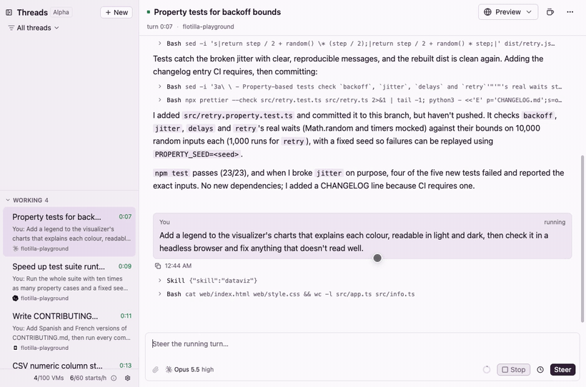
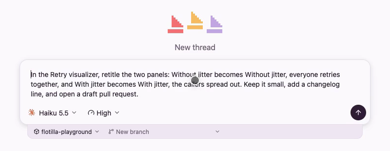
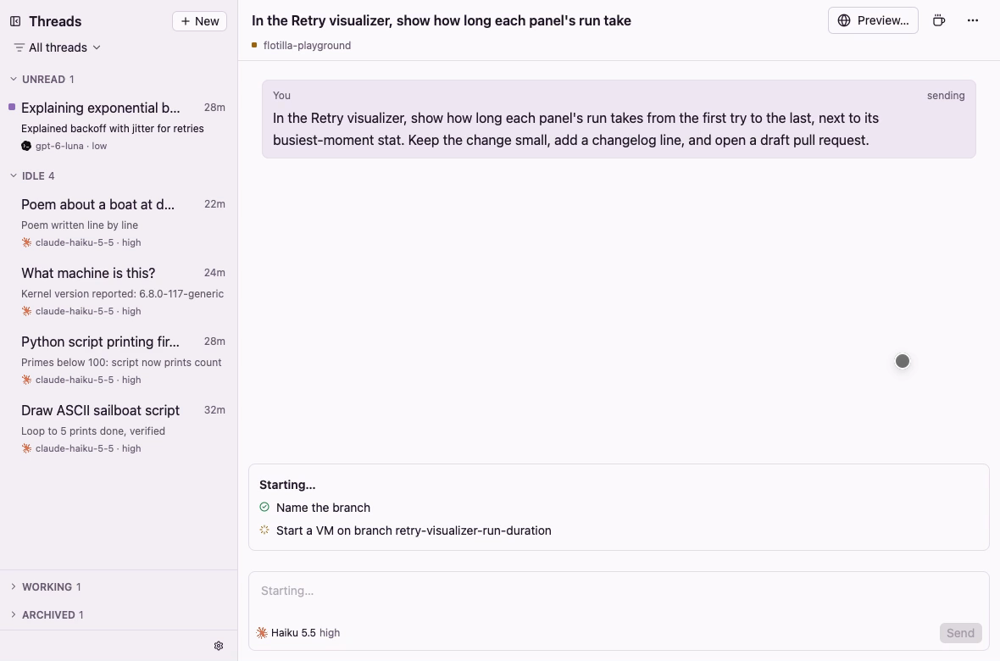
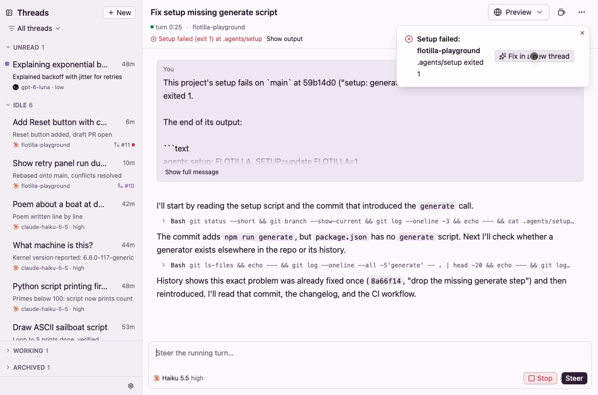
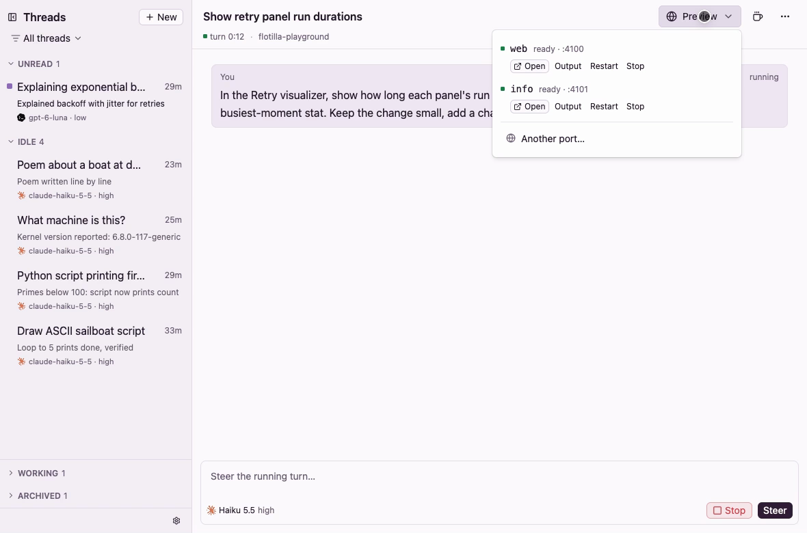

<p align="center"></p>

<h1 align="center">Flotilla</h1>

<p align="center"><strong>A fleet of coding agents, each in its own boat.</strong></p>

<p align="center">Run Claude Code, Codex and OpenCode side by side on your Mac.<br>Each agent works alone in its own isolated cloud VM: its own machine, its own files, its own processes.</p>

<p align="center"><a href="docs/flotilla-demo.mp4"></a></p>

<p align="center"><a href="docs/flotilla-demo.mp4"><strong>▶ Watch the two-minute video</strong></a> · <a href="https://useflotilla.com/docs/"><strong>Read the docs</strong></a></p>

## Why Flotilla

- **Every agent gets its own machine.** Each thread runs in an isolated [boat.dev](https://boat.dev) VM. Agents never step on each other, or on your laptop, your ports or your working copy.
- **Run as many as you like.** Start a thread, start another, switch away. Flotilla tells you when one finishes, and what it said, in a line.
- **From prompt to merged PR.** Add a GitHub repo and every thread starts in its own VM, set up and ready to work. When the pull request needs something, one button writes the prompt. When it's green, hold to merge.
- **Pay for work, not for waiting.** Idle VMs stop on their own and wake the moment you send.

## Features

### Threads in the cloud

- **Claude Code, Codex and OpenCode,** with any model boat.dev offers for them, effort and fast mode.
- **Subagents in view.** When an agent hands work to subagents, each gets a card: what it's doing while it runs, its calls and report when it's done.
- **Watch it work.** Replies and tool calls stream in as they happen. Steer a running turn without stopping it, or stop it.
- **A sidebar that knows what needs you.** Unread first, then idle; working and archived wait at the bottom. A small model on your Mac titles each thread and sums up its latest reply in a line.
- **Small things, done right.** Cite and copy messages, copy code blocks, press ↑ to bring back an earlier prompt.
- **Tidy up in a click.** Archive (⌘Z to undo), rename, or delete a thread and its VM.

<p align="center"></p>

### VMs that sleep

- Idle VMs stop after 5, 10 or 30 minutes, and wake as soon as you send. The header shows how long is left.
- **Keep running** holds a VM up for long jobs.
- **Preview** opens any port in the VM in your browser.

### Projects

- **Add any GitHub repo** your GitHub CLI can see. Flotilla sets it up once and keeps it current as `main` moves.
- **New threads start in seconds,** each in a fresh, isolated VM with your repo already set up.
- **Pick up existing work:** start on any branch or open pull request. Pick it, type `#123`, or paste a link.
- **Filter the sidebar** by project, or show everything.

<p align="center"></p>

### Pull requests

- **The PR lives on the thread.** Checks, changes and what to do next sit right on the message box.
- **One button writes the prompt.** **Fix** for failing checks, **Resolve** for merge conflicts, **Address review** for requested changes. The prompt lands in the message box for you to read before you send.
- **Hold to merge.** No dialog: the button fills while you hold, then merges the way your repo does.
- **Broken setup? Fix it in a new thread.** When a commit breaks setup, one click starts an agent on it with the error and the end of the log.

<p align="center"></p>

### Your repo, your rules

Flotilla reads the `.agents/` folder, the same convention [Amp](https://ampcode.com) uses. Commit any of these:

| File | Runs | Use it for |
| - | - | - |
| `.agents/setup` | When a project is set up, and as each thread starts | Installing dependencies and building. Keep it quick when nothing changed. |
| `.agents/resume` | When a stopped VM wakes, for up to 10 seconds | Signing back in, reconnecting |
| `.agents/archive` | When a thread is archived or deleted | Cleaning up outside the VM, like a database branch |
| `.agents/services.yml` | After setup, and after every wake | Dev servers and anything else that should stay running |

```yaml
# .agents/services.yml
services:
  web:
    command: npm run dev -- --port $PORT
    health: /
    portal: true
```

Services appear in the **Preview** menu with their state, output and Restart, and any port can be made public for an hour, a day, a week or until you stop it. A repo set up for Amp's `.amp/services.yaml` works as it is. [Projects](https://useflotilla.com/docs/main/projects.html#agents-folder) and [Previews](https://useflotilla.com/docs/main/previews.html) in the docs have every field and variable.

<p align="center"></p>

### Other agents can use it

Claude Code, OpenClaw, Hermes Agent and other assistants can start threads, follow them and answer their agents' questions through `flotilla mcp`, an MCP server, as an agent device that can't delete, merge or change settings:

```sh
claude mcp add flotilla -- flotilla mcp
```

Assistants in other clouds (Grok Bot, grok.com, Muse) use remote MCP, which is off unless you turn it on. [The agent API](https://useflotilla.com/docs/main/agent-api.html) in the docs has the setup for each.

### Made for the Mac

Day and Night themes follow macOS, and everything is a keystroke away: ⌘N for a new thread, ⌘K to search threads and what was said in them, ⇧⌘S to archive and open the next. On Linux, Ctrl takes ⌘'s place. [Keyboard shortcuts](https://useflotilla.com/docs/main/shortcuts.html) has the full list.

<p align="center"></p>

## Get started

**You need**

- A Mac with Xcode, or a Linux desktop (Debian or Ubuntu), and [Rust](https://rustup.rs) to build it.
- A [boat.dev](https://boat.dev) account on a paid plan.
- For projects: the [GitHub CLI](https://cli.github.com) signed in (`gh auth login`), and boat.dev's GitHub app installed on the repos you add.
- Optional: the [Claude Code CLI](https://docs.claude.com/en/docs/claude-code) signed in, for thread titles and summaries.

**Build it**

```sh
git clone https://github.com/joseph-lozano/flotilla.git
cd flotilla
script/bundle-macos
open target/release/Flotilla.app
```

**On Linux** (Debian or Ubuntu, X11 or Wayland), build a package and install it:

```sh
sudo apt install build-essential cmake pkg-config libfontconfig-dev libxkbcommon-x11-dev dpkg-dev imagemagick
script/bundle-linux
sudo apt install ./target/release/flotilla_0.1.0_amd64.deb
```

Then open Flotilla from your apps.

**Connect boat.dev.** Make an API key with everything Flotilla uses, and paste it into Settings. It's kept in your macOS Keychain, or on Linux in a file only you can read.

```sh
boat api-key create Flotilla --ttl 365d --actions sandbox.create,sandbox.read,sandbox.update,sandbox.stop,sandbox.resume,sandbox.fork,sandbox.delete-own,agent.prompt,exec,host,snapshot.read,snapshot.write,environment.read,environment.write,account.read
```

Then press ⌘N and tell an agent what to do. [Getting started](https://useflotilla.com/docs/main/getting-started.html) in the docs walks through it.

## FAQ

**Where does my data live?**
On your computer. Your boat.dev key is in the Keychain (on Linux, in a file only you can read), and your threads' history is in a local database. If you use a server, both live on it instead, with the files you attach and the skills you add.

**Can I use it from more than one Mac, or my iPhone?**
Yes. Agents keep working in their VMs with your laptop shut. To keep the rest going too (hand-offs between agents, schedules, setup, notifications, your iPhone), run Flotilla's server on a machine that's always on, like a Linux box, and pair your devices with it:

```sh
cargo build --release -p flotilla-cli && cp target/release/flotilla ~/.local/bin/
flotilla setup --tailscale-serve
flotilla service install
```

[Run a server](https://useflotilla.com/docs/main/server.html) covers pairing, devices, Tailscale, Caddy, Docker and moving your Mac's threads over.

**What does it cost?**
Flotilla itself costs nothing. boat.dev bills VM time, and your model providers bill tokens, as they would anyway. Idle VMs stop on their own, so a quiet thread costs nothing.

**Which agents can I use?**
Claude Code, Codex and OpenCode, with the models boat.dev offers for them. New models show up on their own.

## License

Flotilla is free and open source, under the [MIT License](LICENSE).

## Acknowledgements

Flotilla is inspired by [T3 Code](https://github.com/pingdotgg/t3code) from [Theo](https://t3.gg). Much of Flotilla was built by pointing my coding agents at the T3 Code repo. The new-thread page, the small touches in a thread, and the way the server pairs devices and talks to them all started there. Thank you.
