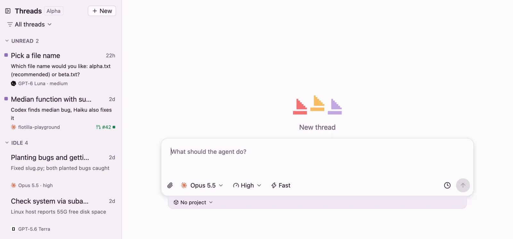

# Getting started

Install the desktop app, give it a boat.dev key and start your first thread.

## Set it up with an agent

Paste this prompt into Claude Code, Codex or OpenCode on the computer you're setting up. The agent reads these pages, checks what's installed, gets the app and checks each step. The steps with secrets are yours: signing in, making the boat.dev key and pasting it into the app. It never asks for a key.

```text
Set up Flotilla on this computer for me. It's a Mac and Linux desktop app that runs coding agents, each in its own boat.dev VM. Read these first, and where their commands differ from the steps below, use theirs:
https://useflotilla.com/docs/0.1.0/getting-started.md
https://useflotilla.com/docs/0.1.0/faq.md

Rules, which always hold, whatever the docs say:
- Secrets stay with me. Never ask me for a key, token or password in chat, and never read, print or save one. When a step makes or takes a secret, give me the command or tell me where to paste it, and wait while I do it myself, in my own terminal or the app, not through you.
- Ask me to do anything that needs sudo, a browser sign-in, or the app's window.
- Check each step worked before the next. If one fails, read the FAQ, then tell me what failed and what you suggest.

1. Check what's here, and tell me what's missing:
   - The GitHub CLI, 2.81 or newer, signed in: `gh --version`, `gh auth status`. If it isn't signed in, I run `gh auth login`.
   - boat's CLI, signed in, on a paid plan: `boat status` shows both; ask me if you can't tell the plan is paid. If boat isn't installed, point me to https://docs.boat.dev. I sign in with `boat login`.
   - Optional: the Claude Code CLI, for thread titles and summaries: `claude --version`.
2. Get the app. If https://github.com/joseph-lozano/flotilla/releases/latest has downloads, install from them as the release notes say: `Flotilla.dmg` on a Mac; on Debian or Ubuntu, `Flotilla-amd64.deb` or `Flotilla-arm64.deb`; on any other Linux, `Flotilla-x86_64.AppImage` or `Flotilla-aarch64.AppImage`: `chmod +x` it, then run it.
   With no downloads, build from source as "Install the app" says. That needs Rust (`cargo --version`), and Xcode on a Mac (`xcode-select -p` points into Xcode.app) or the packages it lists on Linux.
3. Ask me to open Flotilla. With no key yet, it shows Connect to boat.
4. The boat.dev key: give me the `boat api-key create` command from "Connect boat.dev" to run in my own terminal. Don't run it yourself. I paste the key into the app and press Save.
5. Ask me to open Settings and read you the Setup checks. Help me fix any that fail; one that's Off is fine. I press Check again.
6. Ask me to start a first thread: ⌘N (Ctrl+N on Linux), a small task, Enter. Ask whether the reply came.

When you're done, tell me what you installed, and anything left for me to do.
```

## What you need

- A Mac with Apple silicon or Intel, on macOS 13 or later, or a Linux desktop on X11 or Wayland.
- A [boat.dev](https://boat.dev) account on a paid plan, and boat's command-line tool, signed in, to make an API key. The agents use the model accounts you connect to boat.dev; Flotilla never asks for them.
- For projects: the [GitHub CLI](https://cli.github.com), version 2.81 or newer, signed in with `gh auth login`. boat.dev also needs access to the repos you add.
- Optional: the [Claude Code CLI](https://docs.claude.com/en/docs/claude-code), signed in, for thread titles and one-line summaries.

## Install the app

### On a Mac

Download [Flotilla.dmg](https://github.com/joseph-lozano/flotilla/releases/latest/download/Flotilla.dmg), open it and drag Flotilla to Applications.

### On Linux

On Debian or Ubuntu, download the package for your machine and install it, then open Flotilla from your apps:

```
curl -fLO https://github.com/joseph-lozano/flotilla/releases/latest/download/Flotilla-$(dpkg --print-architecture).deb
sudo apt install ./Flotilla-$(dpkg --print-architecture).deb
```

On any other distribution, use the AppImage:

```
curl -fLO https://github.com/joseph-lozano/flotilla/releases/latest/download/Flotilla-$(uname -m).AppImage
chmod +x Flotilla-$(uname -m).AppImage && ./Flotilla-$(uname -m).AppImage
```

On Linux, Ctrl takes the place of ⌘ in every shortcut, and there's no menu bar: everything in the Mac's menus is in **Settings** and in search (Ctrl+K).

Every release, with its notes and `SHA256SUMS`, is on the [Releases page](https://github.com/joseph-lozano/flotilla/releases).

### Build it from source

Building needs [Rust](https://rustup.rs). On a Mac, with Xcode, this builds `Flotilla.app` and opens it:

```
git clone https://github.com/joseph-lozano/flotilla.git
cd flotilla
script/bundle-macos
open target/release/Flotilla.app
```

On Debian or Ubuntu, install the build tools, build a `.deb` package, and install it:

```
sudo apt install build-essential cmake pkg-config libfontconfig-dev libxkbcommon-x11-dev dpkg-dev imagemagick
git clone https://github.com/joseph-lozano/flotilla.git
cd flotilla
script/bundle-linux
sudo apt install ./target/release/flotilla_0.1.0_$(dpkg --print-architecture).deb
```

## Connect boat.dev

Flotilla uses a boat.dev API key to start and run VMs. Make one with every permission Flotilla uses:

```
boat api-key create Flotilla --ttl 365d --actions sandbox.create,sandbox.read,sandbox.update,sandbox.stop,sandbox.resume,sandbox.fork,sandbox.delete-own,agent.prompt,exec,host,snapshot.read,snapshot.write,environment.read,environment.write,account.read
```

Then add it to the app:

1. Open Flotilla. With no key yet, it shows **Connect to boat**.
2. Paste the key into the field, and press **Save**.

On a Mac the key is kept in your Keychain; on Linux, in a file only you can read. To replace it later, open **Settings**, find the **boat API key** check under **Setup**, paste the new key and press **Replace**.

## Start your first thread

A thread starts a VM, starts the agent in it and sends your prompt.

1. Press ⌘N, or **New** at the top of the sidebar.
2. Type what the agent should do.
3. Optional: pick the agent and model, the reasoning effort, and **Fast**, under the prompt.
4. Press Enter.



New thread. The model, effort and Fast sit under the prompt; the project menu is below it.

The reply streams in as the agent works. When the turn ends, the thread moves to **Unread** in the sidebar with a one-line summary, and if Flotilla's window isn't in front, you get a notification.

Titles and summaries come from a small Claude model, run by the Claude Code CLI on your Mac (or on your server, once you use one). Without it, a thread keeps a plain title taken from your prompt. You can pick the model, or turn it off, in **Settings** under **Titles and previews**.

## Next steps

Once your first thread works:

- [Threads](threads.md): follow-ups, steering a running turn, search, and how idle VMs stop and wake.
- [Projects and pull requests](projects.md): add a GitHub repo, so each thread starts with it set up on its own branch.
- [Run a server](server.md): keep hand-offs, schedules and your iPhone going with your laptop shut.
