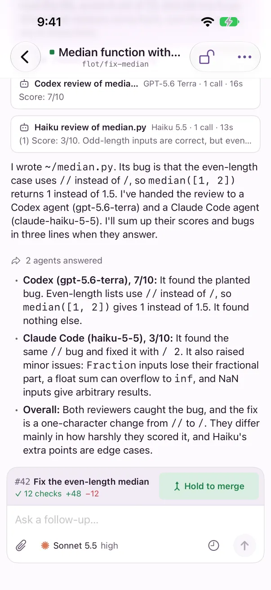
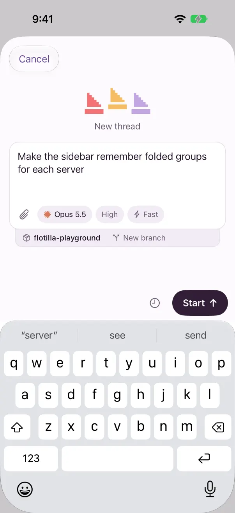
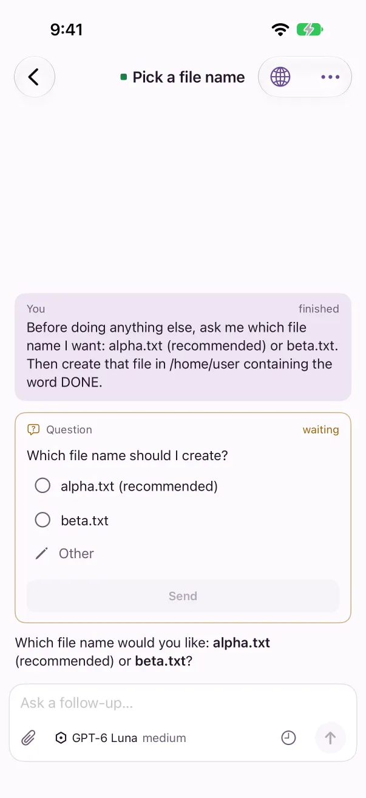
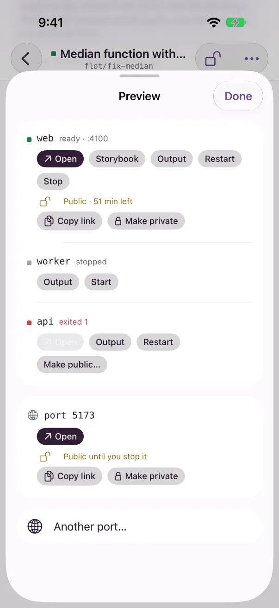

# The iPhone app

The iPhone app shows the same threads as your Mac, live. Start a thread with a photo attached, answer an agent's question, open a preview, and hold to merge with your thumb.

> **Alpha.** The iPhone app isn't on the App Store or TestFlight yet. It needs iOS 26 or later. To try it now, build it from the `ios` folder of the repo with Xcode; its [README](https://github.com/joseph-lozano/flotilla/blob/main/ios/README.md) has the steps.


Threads, grouped by what needs you.



A thread, with its pull request ready to merge.



New thread, in a project on a new branch.

## Pair with your server

The iPhone app connects to a Flotilla server: one you [run on a machine that stays on](server.md), or [your Mac](server.md#use-your-mac-as-the-server) while Flotilla is open there. Your phone needs to reach it, for example over Tailscale.

1. On the server, run `flotilla pair`, or on a paired Mac open **Settings → Devices → Add device**.
2. Open the app. **Connect to a server** shows the camera: point it at the QR code. The form fills in.
3. Check the **Device name**; it's how Settings on your other devices lists this phone.
4. Tap **Connect**.

No camera, or the code is on another screen? Tap **Use a photo of the code**, or fill in **Server** and **Code** yourself. Pasting a whole pairing link into **Server** fills in both. Opening a pairing link on the phone fills in the form too; you still tap **Connect**.

The phone pairs with one server at a time. **Pair with a different server** in Settings replaces the first, which forgets the phone.

## Threads

**Threads** groups threads under **Unread**, **Working** and **Idle**, in that order, with **Archived** folded at the bottom. Each row shows the title, a summary of the latest reply, the agent and model or the project, the pull request's number, and the VM's state, such as *stopped* or *2d left*.

- Swipe left to **Archive** or **Unarchive**; swipe right to mark it read or unread. **Undo** shows for 5 seconds after an archive.
- Touch and hold a row for **Rename…**, **Open the pull request** and **Delete…**, as well as read and archive.
- Search finds threads by title, pull request, branch or project as you type, then **In messages**, what was said in them. Tap a message to open its thread at that message.
- The bar at the bottom shows boat.dev's VM count and the agents' weekly use; tap either for **Usage**. **New thread** is beside them.

## A thread

Replies, tool calls and the cards of agents the thread handed work to stream in live. Tap a tool call to see its output, and touch and hold a message to copy it. **Jump to latest** appears when you scroll up.

- The message box says **Ask a follow-up…**, or **Steer…** while a turn runs. The send button follows the same rules as on the Mac: **Send**, **Steer**, or **Resume and send** when the VM is stopped. **Stop the turn** interrupts it.
- The paperclip attaches photos or files: up to 12, each up to 25 MB, 64 MB in all.
- The model, effort and context ring sit under the message box; tap the ring for the context window.
- The clock is **Send later**. See [Scheduled prompts](schedules.md).
- **⋯** has the thread's menu, and the globe opens **Preview**.

### Questions and pull requests

An agent's question shows as a card: pick an option or tap **Other**, then **Send**. See [Questions from agents](questions.md).

A thread's pull request shows above the message box with its checks. **Fix**, **Resolve** and **Address review** write a prompt for you to check and send. **Hold to merge** fills under your thumb and merges when full. **Ready for review** is on the desktop app only.

### Preview

The globe in a thread's toolbar opens **Preview**. With no services, it asks for a port and opens it. With services, it lists each with **Open**, **Output**, **Restart** or **Start**, **Stop** and **Make public…**, and has **Another port…**. Pages open in Safari inside the app. Public links work as on the Mac; see [Share a public link](previews.md#share-a-public-link).



A question waiting for you.



Preview: services, ports and public links.

## New thread

Tap **New thread**, type what the agent should do, and tap **Start**.

- The model button lists every model by agent. Tap **Select** to pick several and start the prompt on each.
- Effort and **Fast** sit beside it, for models that have them.
- Pick a project, or **No project**, and a branch: **New branch**, or an existing branch or pull request. Type `#12` or paste a link to find one.
- The clock sends it later, as a new thread each run.

## Notifications

The app asks to send notifications the first time it connects. With notifications on, your phone hears when:

- a turn finishes;
- an agent asks you a question;
- the agents a thread handed work to answer;
- a thread couldn't start;
- a pull request merges;
- a scheduled prompt didn't run;
- a project's setup fails.

Tap one to open its thread. While the app is open, it doesn't notify you about the thread you're reading.

### How they reach your phone

Only Flotilla's makers can send notifications to the Flotilla app, so a server without their push key sends them through Flotilla's push relay, `push.useflotilla.com`, which runs on Cloudflare. There's nothing to sign up for: when your server says it uses the relay, your phone registers with it.

- **The relay can't read your notifications.** Your phone makes a key that only it and your server have. The server encrypts each notification with it, and the phone opens it. The relay only passes on a sealed note.
- **What the relay keeps:** your phone's notification token, a random id with a hashed secret, and when it was registered and last used.
- **It deletes them** when you unpair, when Apple reports the app gone, or after 90 days unused (Cloudflare can restore deleted data for 30 days).

To turn the relay off, run this on the server. Your phone then gets no notifications, and leaves the relay:

```
flotilla setup --no-push-relay
flotilla service restart
```

If you build the app yourself under your own Apple developer team, give your server that team's push key instead, and it sends to Apple directly without the relay:

```
flotilla setup --apns-key AuthKey_<KEY ID>.p8 --apns-team-id <TEAM ID>
flotilla service restart
```

The **Push** check in **Server setup** says which it is: through the relay, your own key, or off. See also the [privacy policy](https://useflotilla.com/privacy.html).

## Settings

The gear on Threads opens **Settings**:

- **Server**: the server you're paired with, **Pair with a different server**, and **Forget**.
- **Server setup**: the server's checks, each with the commands that fix it, and **Check again**.
- **Archiving**: archive a thread when its pull request merges, and archive threads idle for a number of days. These are the server's settings, shared with your other devices.
- **Devices**: every paired device, with **Rename…** and **Revoke…**; rename this phone here. **Add device** shows a QR code, the code, and **Copy link** and **Share**.
- **Appearance**: **Phone** (follow the phone), **Day** or **Night**.

Keep running, adding projects, and the other settings are in the desktop app.
