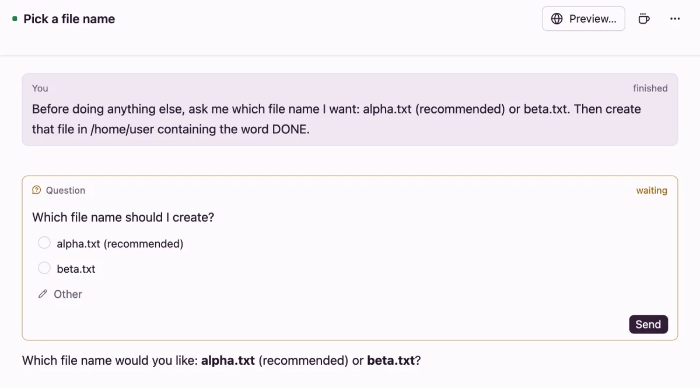

# Questions from agents

When an agent needs you to choose or confirm something before it goes on, it asks with a question card: a few options, the one it recommends first. You answer with a click or a tap, and the agent carries on.

## How agents ask

Every agent is told to ask with the `flotilla ask` command in its VM, rather than in its reply. You don't need to set anything up. To make sure it asks, say so in your prompt, for example *Ask me which database to use before you start.*

- One ask holds up to 3 questions, each with 2 to 4 options. A question can let you pick several.
- After asking, the agent ends its turn and waits. Your answer is its next message.
- If an agent asks more than 3 times in one turn, the extra questions don't show.

Codex's own question tool shows the same way.

## Answer on the Mac or Linux

The question shows in the thread as a card marked *waiting*, and the thread moves to Unread. If the window isn't in front, a notification says *Asks:* and the question.

1. Pick an option, or several where the question allows it.
2. Or press **Other** and type your own answer. On a pick-one question, it takes the place of the option you picked; on a pick-several question, it's added to your picks.
3. Press **Send**.

A question with two options, the recommended one first.

Once answered, the card shows your answers and says *answered*. If you send an ordinary message instead, the card says *not answered*, and the agent reads your message as the reply.

## Answer on your iPhone

The iPhone app shows the same card, with **Other** and **Send**. With notifications set up on your server, a question also comes as a notification; tap it to open the thread. See [notifications](iphone.md#notifications).

## From other agents

An agent that another agent started asks in its final message instead, so the question reaches the agent that started it. Assistants that use Flotilla through [the agent API](agent-api.md) can answer a thread's questions too.
