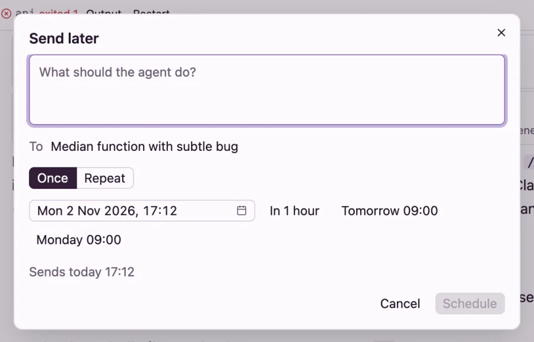

# Scheduled prompts

Send a prompt later: once, or again at most once a day. A schedule sends to one thread as a follow-up, or starts a new thread each time.

## Send later

The clock beside the send button opens **Send later**. Where you open it decides where the prompt goes:

- In a thread, each run sends a follow-up to that thread.
- On New thread, each run starts a new thread with the models and project you picked there.

1. Type what the agent should do. **To** shows where it goes.
2. Pick **Once** and a date and time, or one of **In 1 hour**, **Tomorrow 09:00** and **Monday 09:00**.
3. Or pick **Repeat**, then **Daily**, **Weekdays**, **Weekly** (choose the days) or **Cron**, and the time.
4. Check the line under it, such as *Sends today 17:10*, and press **Schedule**.



Send later, from a thread: each run is a follow-up to it.

A scheduled prompt can't carry files.

### Cron

A cron expression has five fields: minute, hour, day of the month, month and day of the week. It must name one minute and one hour, so it runs at most once a day. For example, `0 9 * * 1-5` is 09:00 on weekdays, and `30 18 1 * *` is 18:30 on the first of each month.

## How runs go

Flotilla runs each schedule by these rules:

- Runs are at least a day apart.
- Times are in the time zone of the device that set the schedule, and stay on the clock across daylight saving changes. A device in another zone sees *times in* and the zone.
- If a turn is running in the thread, the run waits until it ends.
- A run never wakes an archived thread or one whose VM is gone. It pauses the schedule instead, and says why.
- A run that needs a VM start (a new thread, or waking a stopped VM) goes only if boat.dev has at least 5 starts left this hour. Otherwise it doesn't run, and a repeating schedule waits for its next time.
- If the server was off at a repeating schedule's time, that run is skipped and noted as missed. A one-off runs late instead.

When a run doesn't go, you get a *Didn't run* notification with a button that opens the list.

## The Scheduled list

Open it from the clock at the bottom of the sidebar, which shows once you have a schedule, or by searching for **Scheduled prompts** with ⌘K. In a thread with a schedule, a line above the message box shows the next run and opens the list too.

Each schedule shows the start of its prompt, when it runs next, where it goes, and how its last run went. For each one:

- the switch pauses it, or resumes it from now;
- **Run now** sends it at once and leaves its next run as it is;
- **Edit** opens the form again;
- **Delete** deletes it at once, without asking.

One-off schedules leave the list 7 days after they run.

## Where schedules run

Schedules run on Flotilla's server. On **This Mac**, that's the app, so they run only while Flotilla is open, and the list says so. To have them run with your laptop shut, [run a server](server.md).

## From the command line

On the machine that runs the server, `flotilla schedule` does the same:

```
flotilla schedule add --thread 7f3e --daily 09:00 "Check the overnight CI runs"
flotilla schedule add --provider claude-code --model claude-haiku-5-5 --weekdays 08:30 "Triage new bugs"
flotilla schedule add --thread 7f3e --in 2h "Merge it if the checks pass"
flotilla schedule list
flotilla schedule pause 2a87
flotilla schedule run 2a87
flotilla schedule rm 2a87
```

Times take `--at HH:MM` or `--at "YYYY-MM-DD HH:MM"`, `--in 30m`, `--daily`, `--weekdays`, `--weekly mon,wed@18:00` or `--cron`, and `--zone` for another time zone. Ids can be shortened to their first few characters. Every command but `list` needs Flotilla running there: the server, or the app. New threads scheduled this way have no project.
