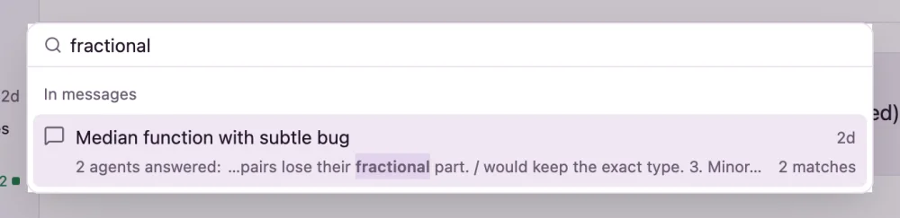
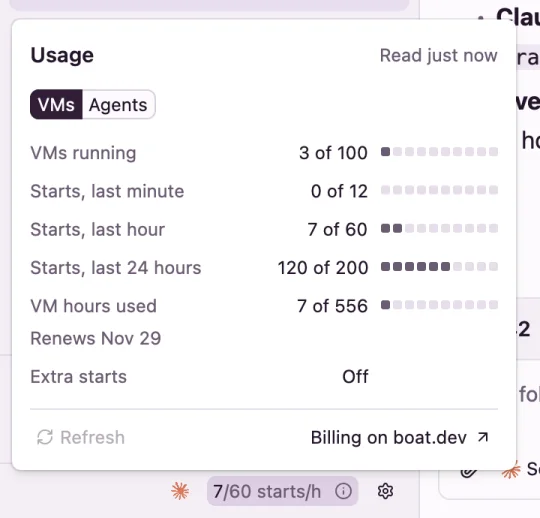

# Threads

A thread is one conversation with one agent, in a VM of its own. This page covers starting one, working in it, finding it again and putting it away.

## Start a thread

Open **New thread** with ⌘N or the **New** button at the top of the sidebar, type what the agent should do, and press Enter.

- Enter starts the thread and opens it. ⌘Enter starts it and leaves you on New thread, with the project, branch and models kept, ready for the next one.
- The project menu under the prompt picks a GitHub repo, or **No project** for a blank VM. See [Projects and pull requests](projects.md).
- The clock by the start button sends the prompt later instead. See [Scheduled prompts](schedules.md).

## Pick the agent and model

The model button under the prompt opens one searchable list, grouped by agent: **Claude Code**, **Codex** and **OpenCode**. The models are the ones boat.dev offers for each agent, so new ones show up on their own. New threads start on the default you set in **Settings** under **New threads**.

- **Effort** (the gauge) sets the reasoning effort. It shows only for models that have effort levels, and lists that model's levels.
- **Fast** turns on fast mode. It shows only for models that have it.
- A thread keeps its model. To try another, start a new thread.

### One prompt on several models

To compare models, start the same prompt on several at once. In the model list, ⇧-click more models, or press the **+** that appears beside a model when you point at it. The button then reads, for example, *Opus 5.5 + GPT-6.1 Sol*, and one thread starts for each model.

- In a project, each model needs a branch of its own, so pick **New branch**. Each branch name ends in its model's name.
- Each thread is a VM start, so boat.dev's start limits apply. If boat.dev won't start that many now, Flotilla says how many it can start.

## Follow up, steer or stop

Type in the message box at the bottom of a thread. Enter sends, and ⇧Enter starts a new line. The send button changes with the thread's state:

| Button | When | What happens |
| --- | --- | --- |
| **Send** | The agent is idle. | Your message starts a new turn. |
| **Steer** | A turn is running. | Your message goes into the running turn without stopping it, and shows as *You steered*. Files wait for the next prompt. |
| **Resume & send** | The VM is stopped. | The VM wakes, then your message starts a turn. |

While a turn runs, **Stop** interrupts it. A message that couldn't be sent stays in the thread with **Send again** and **Discard**.

- Press ↑ in an empty message box to bring back an earlier prompt, and ↓ to go forward again.
- Right-click a message for **Copy**, **Copy message**, and **Cite message** or **Cite selection**, which quotes it into the message box.
- Code blocks have their own copy button.

## Attach files

Press the paperclip, or drop files on the message box. Images show as thumbnails; **×** removes a file before you send. A prompt can carry up to 12 files, each up to 25 MB, and 64 MB in all.

## Slash commands, skills and @-mentions

Three characters open a menu of things the agent in the VM can use. The menus read the VM, so they show once it's running.

| Type | Lists |
| --- | --- |
| `/` | The agent's skills and commands found in the VM, with their descriptions. For Claude Code and OpenCode, the one you pick moves to the start of the prompt, where those agents look for it. |
| `$` | Codex's skills, on Codex threads. Elsewhere, `$` is a dollar sign. |
| `@` | Files and folders in the thread's repo. Picking a folder opens it. |

Move with ↑ and ↓, pick with Enter or Tab, and close with Esc. To give every agent your own skills or standing instructions, use **Skills for every agent** and **Instructions for every agent** in [Settings](settings.md#instructions-and-skills-for-every-agent).

## Search

Press ⌘K to search threads, messages and commands.

- With nothing typed, it lists the open thread's commands, the app's commands, and your latest threads.
- Type to find threads by title, pull request (number, title or link), branch or project.
- **In messages** finds what was said in threads. It looks up words of three letters or more, in any case. Pick a result to open its thread at that message.
- Start with `>` to see only commands.

A word found in a thread's messages. Picking it opens the thread at that message.

## The sidebar

The sidebar sorts threads by what they need from you:

- **Unread**: a turn ended, and you haven't looked yet.
- **Idle**: read, and waiting for you.
- **Working**: a turn is running, or the thread waits on a hand-off.
- **Archived**: put away. It starts folded; click its heading to open it.

Each row shows the title, how long ago it was active (or how long the turn has run), a summary of the latest reply, the agent and model or the project, and the pull request's number. Point at a row for a card with its agent, VM, project, branch and pull request. Double-click a row to rename the thread, and right-click it for the thread's menu.

Once you have projects, **All threads** at the top filters the sidebar by project. You can drag the sidebar's edge to resize it, and hide it with ⌃⌘S (F9 on Linux).

## Archive, unarchive and delete

Archive a thread when you're done with it. Its VM stops, and if the repo has an `.agents/archive` script, it runs first.

- Point at a sidebar row and press the archive button that takes the place of its time, or pick **Archive** from the thread's menu.
- **Archive and open next** (⇧⌘S) archives the open thread and opens the next one, unread threads first.
- For 5 seconds after, **Undo** (⌘Z) brings it back.
- **Unarchive**, in the thread's header or menu, brings it back later. Its VM wakes on your next message.

Flotilla can archive for you, when a thread's pull request merges or after it's been idle a while: see [Archiving](settings.md#archiving) in Settings.

**Delete…** deletes the thread's VM and its history. It can't be undone.

### The thread menu

The same menu opens from **⋯** in the thread's header, from a right-click on its sidebar row, and from search:

- **Mark as unread** or **Mark as read**
- **Archive** or **Unarchive**
- **Stop VM** or **Resume VM**
- **Rename…**
- On a project thread: **Open PR on GitHub**, **Copy branch name**, **New thread on this branch** and **Link a PR…**
- **Copy thread ID**, **Copy VM ID**
- **Delete…**

## Idle VMs: stop, wake and keep running

A VM that's idle stops on its own, so you pay for work, not waiting. Choose how long it waits in **Settings** under **Stop idle VMs after**: 5, 10 (the default) or 30 minutes. A change applies from each thread's next turn. boat.dev stops the VM when its time is up, so it stops even with Flotilla closed.

- Point at the dot by the thread's title for when it stops, or at its sidebar row for the minutes left.
- Send to a stopped thread and its VM wakes, with your files where they were. If the repo has an `.agents/resume` script, it runs first.
- **Stop VM** and **Resume VM** in the thread menu do it by hand.
- **Keep running**, the cup in the thread's header, keeps the VM up while it's idle, for long jobs or a dev server you're using. Press it again to let it stop.

boat.dev keeps a stopped VM for 14 days. In its last three days, its sidebar row shows the days left. After that the thread is **Expired**: its history stays, under Archived, but the VM is gone. To carry on a project thread's work, use **New thread on this branch**.

## Usage and limits

The bottom of the sidebar shows boat.dev's counts, such as *7/60 starts/h*, and, once the agents have reported it, how much of each agent account's weekly limit is used. Click either for **Usage**:

- **VMs**: VMs running, starts in the last minute, hour and 24 hours, VM hours used this plan period, and extra starts, each against its limit. When boat.dev won't start VMs, it says why and when they can start again. **Billing on boat.dev** opens your plan.
- **Agents**: each agent account's weekly limit, how much is used and when it resets, then the last 30 days: what the agents' tokens would cost at API prices, what the cache saved, by day and by model.

Usage, on the VMs tab.

When an agent account runs out, the message box says so, for example *Claude limit reached · resets* and when.

## The context meter

Beside the send button, a ring shows how full the agent's context window is, once the agent reports it. It turns amber at 80% and red at 90%. Point at it for the tokens used and the window's size.

## Notifications

When Flotilla's window isn't in front, a notification tells you when a thread needs you: a turn finished, an agent asks a question, the agents a thread handed work to answered, a thread couldn't start, a pull request merged, a scheduled prompt didn't run, or a project's setup failed. Click it to open the thread. Threads that agents started don't notify; their answers come back to the thread that asked.

The Dock icon (on Linux, the launcher) shows how many threads are unread. In the window, a thread you're not looking at shows **Thread finished** or **Thread asks**, with **Open**. Turn banners and the count off in [Settings](settings.md#notifications).
